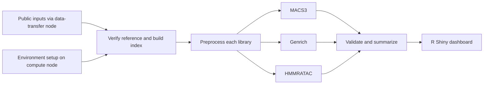

# Study plan: ATAC-seq peak caller comparison

## Question and scope

How do MACS3, Genrich, and HMMRATAC differ in their accessible-region calls when applied to the same human GM12878 Omni-ATAC libraries? This is a reproducible descriptive case study, not a truth-set benchmark or a search for a universally best caller.

Use both complete paired-end libraries, SRR5427887 (RepA) and SRR5427886 (RepB), from PRJNA380283 / SRP103230. The experiment aliases identify replicate libraries from the same cell line; they do not represent independent human donors. Published use of these exact runs, original protocol provenance, file checksums, and method-comparison precedents are recorded in [research.md](research.md). Analysis uses hg38 and a matching blacklist.

The user will transfer the project and submit jobs to Hellbender. Local preparation and software tests are separate from completion of the scientific run.

## Prespecified implementation

1. Verify all four public FASTQ files with provider MD5 checksums. Preserve full inputs and their metadata. Record reference provenance and content digests.
2. Process each library separately: paired-end trimming, Bowtie2 alignment, mate fixing, duplicate marking, and whole-pair filtering. Require properly paired primary mapped reads, both mates passing MAPQ 30, no QC-fail or duplicate flags, and an autosomal/X/Y fragment outside the blacklist. Retain nucleosome-length fragments. The shared input BAM has no global Tn5 shift.
3. Supply the same retained alignments in the format each caller needs: coordinate-sorted paired-end BAM to MACS3 and HMMRATAC, queryname-sorted BAM to Genrich. Call MACS3 in BAMPE mode and Genrich in ATAC mode. Use MACS3's maintained HMMRATAC implementation with a fixed seed; document implementation and version rather than equating it with the original Java executable.
4. Keep native output. Validate and export zero-based, half-open peak intervals with consistent contig and blacklist rules. Empty successful peak files remain distinct from absent or failed outputs.
5. Compute per-library metrics and within-caller replicate agreement. Export summaries for Shiny; preserve raw logs, runtime measurements, configuration, software versions, and checksums.

## Comparisons and interpretation

| Measure | Definition | Interpretation limit |
|---|---|---|
| Number of peaks | Count of final intervals, without union-merging | Caller segmentation differs |
| Width | Median and quartiles of final interval widths | Broad HMM regions may differ from narrow calls |
| Covered bases | Size of union of final intervals | More coverage can increase overlap and FRiP |
| Base-pair Jaccard | Intersection / union of merged interval sets | Agreement, not accuracy; undefined if both empty |
| Directional peak agreement | Fraction of A's peaks with at least 1 bp overlap in B | Depends on interval widths and peak counts |
| FRiP | Eligible paired fragments overlapping at least one peak / all eligible paired fragments | Fragment-span definition; each fragment counted once; not an independent quality verdict |
| Replicate agreement | Same Jaccard and directional measures between libraries within a caller | One cell line and two libraries; no donor-level inference |
| Time and memory | Measured caller wall time and peak resident memory | Hardware and scheduling context must be retained |

MACS3 and Genrich q cutoffs can be stated numerically, but they are not interchangeable statistical models. HMMRATAC does not receive an invented equivalent q cutoff. No sensitivity, specificity, precision, ROC curve, or ranking as "best" will be reported without a defensible truth set.

## Execution and failure handling

SLURM dependencies gate stages on successful upstream completion. Resource requests, account, partition, and locations are editable. Heavy work runs on compute nodes; large transfers follow the Hellbender data-transfer guidance. Reruns must not silently reuse stale outputs after configuration changes. Failed callers must not be replaced with dummy peaks.

## Acceptance criteria

- Input accessions, organism, paired-end layout, references, and provider checksums are recorded.
- Tests cover pair integrity, bad mate quality, duplicate/blacklist handling, half-open interval boundaries, union overlap, FRiP deduplication, empty peak sets, missing outputs, and inconsistent denominators.
- Submission scripts pass syntax/preflight checks and save job IDs and provenance.
- Shiny handles empty, partial, and valid result bundles and provides downloadable measured tables.
- Scientific completion requires all full libraries and all three callers to run successfully, with validated metrics. Script creation, fixture tests, or job submission alone do not satisfy that criterion.

## Deferred extensions

Matched DNase agreement, TSS enrichment, IDR, equal-number-of-peaks sensitivity analysis, pooled calls, biological differential accessibility, and additional cell types are outside the first implementation. These should be added with their own definitions and validation, not implied by the initial dashboard.
