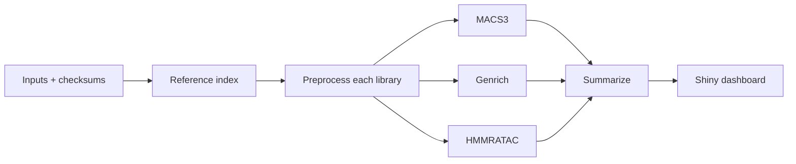

# Study plan

## Question

How do MACS3, Genrich, and HMMRATAC differ when they call peaks on the same ATAC-seq libraries? This is a descriptive case study. It is not a benchmark against ground truth, and it does not set out to rank the callers.

## Design

Each library was preprocessed once, and the same filtered alignments went to all three callers. Each caller ran on each library separately. We then compared the callers within each library, and the libraries within each caller.

## Measures

| Measure | Definition | Caveat |
|---|---|---|
| Peak count | Number of final intervals | Callers segment regions differently |
| Width | Median and quartiles of interval width | HMMRATAC regions are much narrower |
| Covered bases | Size of the merged interval union | Broader calls inflate overlap and FRiP |
| Jaccard | Intersection / union, in base pairs | Measures agreement, not accuracy |
| Directional overlap | Fraction of A's peaks overlapping B by at least 1 bp | Depends on width and count |
| FRiP | Fraction of retained fragments overlapping any peak | Rises with permissive cutoffs |
| Replicate agreement | Jaccard between RepA and RepB within one caller | Technical replicates; not IDR |
| Time and memory | Wall time and peak RSS of the caller step | Depends on the hardware used |

## Out of scope

We did not compare against DNase or other reference annotations, compute TSS enrichment or IDR, test sensitivity at matched peak numbers, call peaks on pooled libraries, test differential accessibility, or include other cell types. Each of these would need its own definitions and validation.
